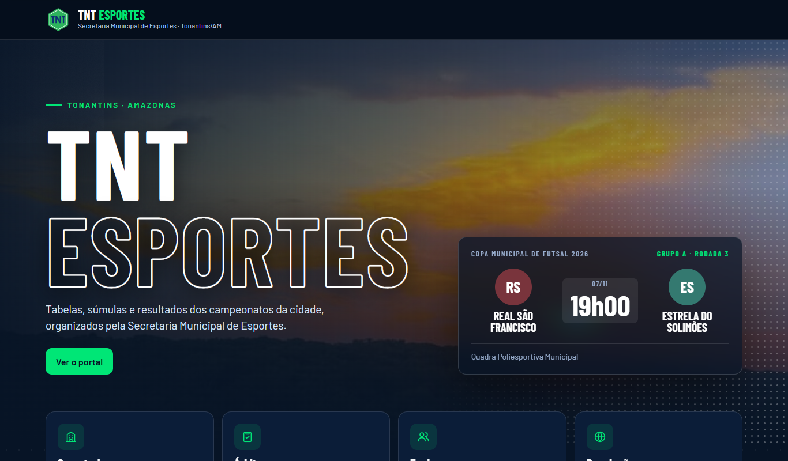
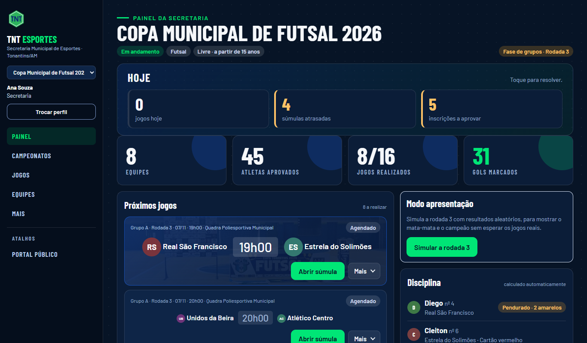

# TNT Esportes

**Portal dos campeonatos da Secretaria Municipal de Esportes de Tonantins/AM: inscrições, sorteio, súmula digital e tabelas públicas.**

A Secretaria organiza o campeonato, o árbitro preenche a súmula no celular (até sem internet), as equipes inscrevem os atletas e a população acompanha tudo no portal público.


**[▶ Ver o portal](https://anndreluizz.github.io/tnt-esportes/)** · **[Testar a demonstração](https://anndreluizz.github.io/tnt-esportes/demo.html)** (dados fictícios) · **[Manual de uso](https://anndreluizz.github.io/tnt-esportes/manual.html)**



## Quatro perfis, um sistema

| Perfil | O que faz |
|---|---|
| **Secretaria** | Cria campeonatos, aprova inscrições, sorteia grupos, monta a tabela de jogos, acompanha disciplina e súmulas atrasadas |
| **Árbitro** | Súmula digital no celular: gols, cartões e assinatura. Funciona sem internet e envia depois |
| **Equipe** | Faz a conta, inscreve atletas com foto e documento e acompanha elenco e jogos |
| **Público** | Tabelas, classificação, artilharia, jogos e resultados, sem login |



## Destaques

- **Regras do campeonato automáticas**: fase de grupos, mata-mata, classificação, desempate, artilharia, pendurados e suspensos
- **Sorteio e calendário** gerados a partir das equipes e das datas disponíveis
- **Súmula offline**: o árbitro preenche na beira da quadra, sem sinal, e o app sincroniza depois
- **Modo apresentação**: simula uma rodada para mostrar o mata-mata e o campeão sem esperar os jogos
- **Acessível**: foco visível, contraste conferido em auditoria no site publicado, respeita `prefers-reduced-motion`
- **Instalável** no celular (PWA)

## Como funciona

Páginas estáticas (HTML, CSS e JavaScript, sem framework) + Supabase (PostgreSQL, Auth e Storage). As regras de acesso ficam no banco, com políticas de acesso por linha (RLS).

```
Navegador / celular (PWA)  ──▶  Supabase (PostgreSQL + Auth + Storage)
 portal · painel · súmula         RLS, auditoria e armazenamento de fotos
```

## Testes

O CI roda a cada envio, com um Postgres local (PGlite), sem tocar no banco de produção:

- telas e regras de campeonato (`node checar.js`)
- banco, privacidade e políticas de armazenamento
- auditoria de alterações
- volume: 16 equipes, 300 atletas, 120 jogos e mais de 1.200 eventos

```
node checar.js
cd supabase && npm install && npm test
```

O guia visual do projeto está em [`DESIGN.md`](DESIGN.md).

---

Desenvolvido por [André Luís Coelho Lopes](https://github.com/anndreluizz) · Tonantins, AM
